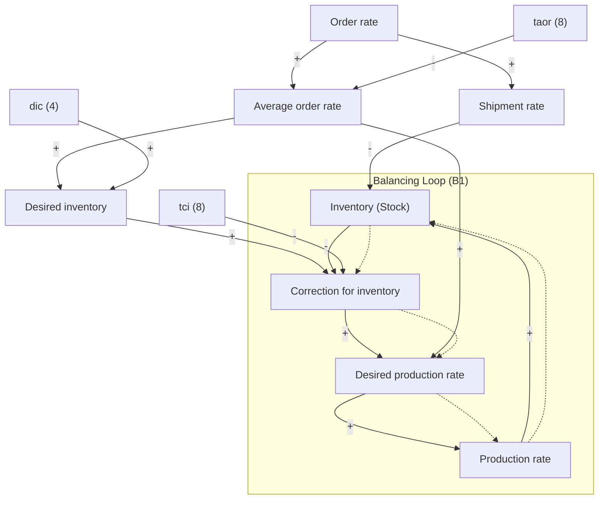
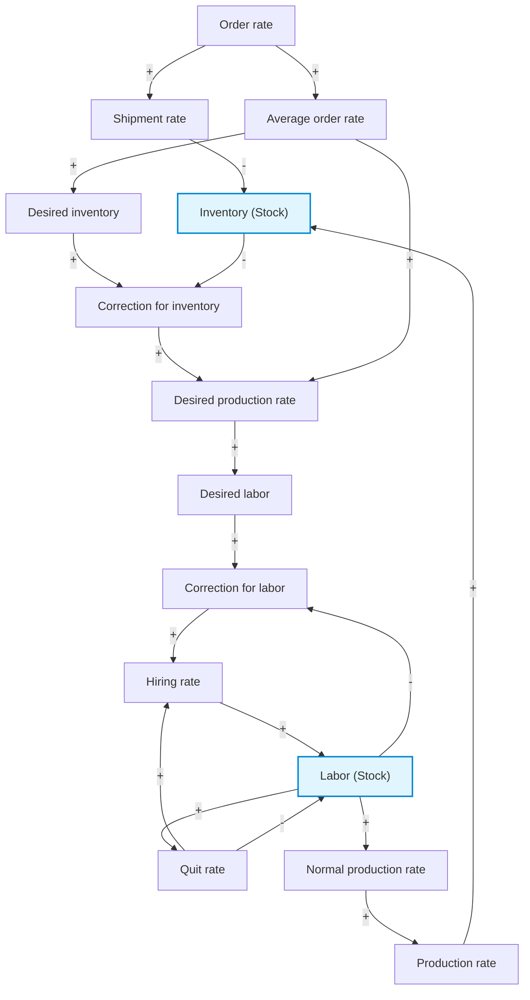

# LAPORAN LENGKAP & VALIDASI MODEL SYSTEM DYNAMICS
## Kasus: Production and Inventory (Model 1 & Model 2)
**Folder Output:** `FIXED/`  
**Berdasarkan Standar:** [PANDUAN VENSIM.md](../PANDUAN%20VENSIM.md) & Kunci Jawaban UTS PKTSD 2023

---

## 1. Daftar File Hasil di Folder `FIXED/`

Semua file telah divalidasi dengan pengecekan sintaks native Vensim, lolos *Check Model* dan *Units Check* dengan 0 error dan 0 warning:

| Nama File | Tipe | Deskripsi |
| :--- | :---: | :--- |
| [SFD1_Production_Inventory.mdl](file:///c:/Users/fhera/Downloads/Development/Efha-Vensim%20Modelling/FIXED/SFD1_Production_Inventory.mdl) | Model Vensim | Stock & Flow Diagram Model 1 (Kapasitas produksi fleksibel) |
| [SFD2_Production_Inventory_Labor.mdl](file:///c:/Users/fhera/Downloads/Development/Efha-Vensim%20Modelling/FIXED/SFD2_Production_Inventory_Labor.mdl) | Model Vensim | Stock & Flow Diagram Model 2 (Kapasitas dibatasi tenaga kerja & tunda 24 minggu) |
| [CLD1_Production_Inventory.mdl](file:///c:/Users/fhera/Downloads/Development/Efha-Vensim%20Modelling/FIXED/CLD1_Production_Inventory.mdl) | Model Vensim | Causal Loop Diagram native Model 1 lengkap dengan tanda +/- dan marker B1 |
| [CLD2_Production_Inventory_Labor.mdl](file:///c:/Users/fhera/Downloads/Development/Efha-Vensim%20Modelling/FIXED/CLD2_Production_Inventory_Labor.mdl) | Model Vensim | Causal Loop Diagram native Model 2 lengkap dengan loop B1, B2, B3, dan R1 |
| [sfd1_sim_results.csv](file:///c:/Users/fhera/Downloads/Development/Efha-Vensim%20Modelling/FIXED/sfd1_sim_results.csv) | Data Simulasi | Output numerik lengkap Model 1 ($t = 0 - 100$, dt = 1) |
| [sfd2_sim_results.csv](file:///c:/Users/fhera/Downloads/Development/Efha-Vensim%20Modelling/FIXED/sfd2_sim_results.csv) | Data Simulasi | Output numerik lengkap Model 2 ($t = 0 - 100$, dt = 1) |
| [sfd1_simulation_graph.png](file:///c:/Users/fhera/Downloads/Development/Efha-Vensim%20Modelling/FIXED/sfd1_simulation_graph.png) | Grafik Resolusi Tinggi | Grafik hasil simulasi Model 1 (reproduksi kurva soal) |
| [sfd2_simulation_graph.png](file:///c:/Users/fhera/Downloads/Development/Efha-Vensim%20Modelling/FIXED/sfd2_simulation_graph.png) | Grafik Resolusi Tinggi | Grafik hasil simulasi Model 2 (reproduksi kurva soal) |

---

## 2. Analisis Causal Loop Diagram (CLD) & Umpan Balik (Feedback Loops)

### A. CLD Model 1 (Sistem Persediaan Tanpa Kendala Kapasitas)

#### 1. Tabel Relasi Kausal & Polaritas
Polaritas ditentukan secara analitis dari turunan parsial persamaan matematis ($\partial Y / \partial X$):

| Sebab ($X$) | Akibat ($Y$) | Persamaan yang Mendasari | $\partial Y / \partial X$ | Tanda | Penjelasan Mekanisme |
| :--- | :--- | :--- | :---: | :---: | :--- |
| **Order rate** | **Shipment rate** | `Shipment rate = Order rate` | $+1$ | **+** | Kenaikan pesanan langsung menaikkan pengiriman barang ke konsumen. |
| **Shipment rate** | **Inventory** | `d(Inventory)/dt = Production - Shipment` | $-1$ | **-** | Pengiriman adalah *outflow*, sehingga mengurangi persediaan fisik. |
| **Order rate** | **Average order rate** | $\text{SMOOTH}(\text{Order rate}, \text{taor})$ | $> 0$ | **+** | Kenaikan pesanan menaikkan peramalan rata-rata permintaan. |
| **taor** | **Average order rate** | $\text{Smoothing delay}$ | $< 0$ | **-** | Semakin panjang waktu peramalan, respon rata-rata semakin lambat/teredam. |
| **Average order rate** | **Desired inventory** | `Average order rate * dic` | $\text{dic} = 4 > 0$ | **+** | Naiknya perkiraan pesanan menaikkan target persediaan penyangga. |
| **dic** | **Desired inventory** | `Average order rate * dic` | $\text{AOR} > 0$ | **+** | Semakin lama cakupan minggu persediaan, semakin besar target stok. |
| **Desired inventory** | **Correction for inventory**| `(Desired inventory - Inventory)/tci` | $+1/\text{tci} > 0$ | **+** | Naiknya target persediaan memperbesar defisit/koreksi persediaan. |
| **Inventory** | **Correction for inventory**| `(Desired inventory - Inventory)/tci` | $-1/\text{tci} < 0$ | **-** | Makin banyak stok aktual di gudang, makin kecil koreksi yang dibutuhkan. |
| **tci** | **Correction for inventory**| `(Desired inventory - Inventory)/tci` | $< 0$ | **-** | Semakin lama waktu penyesuaian, semakin kecil laju koreksi per minggu. |
| **Average order rate** | **Desired production rate**| `Average order rate + Correction for inv`| $+1$ | **+** | Produksi yang diinginkan harus mengimbangi perkiraan laju penjualan. |
| **Correction for inv** | **Desired production rate**| `Average order rate + Correction for inv`| $+1$ | **+** | Koreksi ditambahkan langsung ke rencana produksi mingguan. |
| **Desired prod rate** | **Production rate** | `Production rate = Desired production rate`| $+1$ | **+** | Pada Model 1 kapasitas fleksibel, produksi aktual mengikuti target. |
| **Production rate** | **Inventory** | `d(Inventory)/dt = Production - Shipment` | $+1$ | **+** | Produksi adalah *inflow*, menambah stok persediaan di gudang. |

#### 2. Identifikasi Loop Model 1
* **Loop B1 (Inventory Correction Loop - Balancing Loop)**:
  $$\text{Inventory} \xrightarrow{(-)} \text{Correction for inventory} \xrightarrow{(+)} \text{Desired production rate} \xrightarrow{(+)} \text{Production rate} \xrightarrow{(+)} \text{Inventory}$$
  * **Jumlah Tanda Negatif**: 1 (Ganjil) $\implies$ **Balancing Loop (B1)**.
  * **Peran**: Menjaga kestabilan sistem dengan mengarahkan persediaan riil ke target persediaan (*goal-seeking*).
* **Information Smoothing Loop**:
  Secara internal, fungsi `SMOOTH(Order rate, taor)` membentuk loop umpan balik negatif informasi:
  $$\text{Average order rate} \xrightarrow{(-)} \text{Change in AOR} \xrightarrow{(+)} \text{Average order rate}$$
  Loop ini bertindak sebagai filter peredam fluktuasi jangka pendek.

#### 3. Diagram CLD Model 1 (Mermaid)

---

### B. CLD Model 2 (Sistem Terintegrasi dengan Sektor Tenaga Kerja)

Pada Model 2, asumsi fleksibilitas kapasitas dibatalkan. Ketersediaan tenaga kerja menjadi pembatas fisik volume produksi riil, di mana perekrutan dan pelatihan membutuhkan waktu agregat `tcl = 24 minggu`.

#### 1. Tabel Relasi Kausal Tambahan di Sektor Tenaga Kerja

| Sebab ($X$) | Akibat ($Y$) | Persamaan | $\partial Y / \partial X$ | Tanda | Penjelasan Mekanisme |
| :--- | :--- | :--- | :---: | :---: | :--- |
| **Desired prod rate**| **Desired labor** | `Desired prod rate / Productivity` | $+1/20 > 0$ | **+** | Kenaikan target produksi menaikkan kebutuhan jumlah personil. |
| **Avg labor prod** | **Desired labor** | `Desired prod rate / Productivity` | $< 0$ | **-** | Semakin produktif per pekerja, semakin sedikit orang yang dibutuhkan. |
| **Desired labor** | **Correction for labor** | `(Desired labor - Labor) / tcl` | $+1/\text{tcl} > 0$ | **+** | Kekurangan pekerja memicu kebutuhan rekrutmen penyesuaian. |
| **Labor** | **Correction for labor** | `(Desired labor - Labor) / tcl` | $-1/\text{tcl} < 0$ | **-** | Makin banyak pekerja aktual, makin kecil kebutuhan penambahan. |
| **tcl** | **Correction for labor** | `(Desired labor - Labor) / tcl` | $< 0$ | **-** | Makin lama waktu rekrutmen/pelatihan, laju adaptasi per minggu makin lambat. |
| **Correction for labor**| **Hiring rate** | `Quit rate + Correction for labor` | $+1$ | **+** | Defisit tenaga kerja menambah laju perekrutan mingguan. |
| **Quit rate** | **Hiring rate** | `Quit rate + Correction for labor` | $+1$ | **+** | Kebijakan *replacement hiring* langsung mengganti pekerja yang keluar. |
| **Hiring rate** | **Labor** | `d(Labor)/dt = Hiring - Quit` | $+1$ | **+** | Perekrutan menambah jumlah stok tenaga kerja (*inflow*). |
| **Labor** | **Quit rate** | `Labor / ade` | $+1/\text{ade} > 0$| **+** | Semakin banyak pekerja, semakin banyak jumlah orang yang berhenti per minggu. |
| **ade** | **Quit rate** | `Labor / ade` | $< 0$ | **-** | Makin lama masa kerja (50 minggu), makin kecil persentase keluar per minggu. |
| **Quit rate** | **Labor** | `d(Labor)/dt = Hiring - Quit` | $-1$ | **-** | Pengunduran diri mengurangi jumlah stok tenaga kerja (*outflow*). |
| **Labor** | **Normal prod rate** | `Labor * Avg labor prod` | $+20 > 0$ | **+** | Jumlah personil menentukan kapasitas produksi normal mingguan. |
| **Avg labor prod** | **Normal prod rate** | `Labor * Avg labor prod` | $\text{Labor} > 0$| **+** | Produktivitas tinggi melipatgandakan output barang. |
| **Normal prod rate** | **Production rate** | `Production rate = Normal prod rate`| $+1$ | **+** | Tidak ada lembur/undertimework, produksi riil = kapasitas normal. |

#### 2. Identifikasi Umpan Balik Lengkap (Balancing & Reinforcing Loops)

1. **Loop B1 (Major Inventory & Production Control Loop - Balancing)**:
   $$\text{Inventory} \xrightarrow{(-)} \text{Correction for inv} \xrightarrow{(+)} \text{Desired prod} \xrightarrow{(+)} \text{Desired labor} \xrightarrow{(+)} \text{Correction for labor} \xrightarrow{(+)} \text{Hiring rate} \xrightarrow{(+)} \text{Labor} \xrightarrow{(+)} \text{Normal prod} \xrightarrow{(+)} \text{Production} \xrightarrow{(+)} \text{Inventory}$$
   * **Jumlah Tanda Negatif**: 1 (Ganjil) $\implies$ **Balancing Loop**.
   * **Karakter Dinamis Kritis**: Ini adalah loop balancing **orde tinggi** yang menghubungkan dua stok fisik (`Inventory` dan `Labor`) dengan dua penundaan besar (`tci = 8 minggu` dan `tcl = 24 minggu`). Penundaan fasa (*phase lag*) agregat sebesar 32 minggu ini menyebabkan tindakan koreksi datang terlambat, memicu fenomena **damped oscillation** (puncak dan lembah yang berosilasi).

2. **Loop B2 (Labor Adjustment Loop - Balancing)**:
   $$\text{Labor} \xrightarrow{(-)} \text{Correction for labor} \xrightarrow{(+)} \text{Hiring rate} \xrightarrow{(+)} \text{Labor}$$
   * **Jumlah Tanda Negatif**: 1 (Ganjil) $\implies$ **Balancing Loop**.
   * **Fungsi**: Mengoreksi jumlah pekerja aktual agar mendekati target kebutuhan tenaga kerja dengan konstanta waktu 24 minggu.

3. **Loop B3 (Workforce Depletion / Attrition Loop - Balancing)**:
   $$\text{Labor} \xrightarrow{(+)} \text{Quit rate} \xrightarrow{(-)} \text{Labor}$$
   * **Jumlah Tanda Negatif**: 1 (Ganjil) $\implies$ **Balancing Loop**.
   * **Fungsi**: Pengurangan alami stok pekerja akibat berhentinya karyawan dengan rata-rata masa kerja 50 minggu.

4. **Loop R1 (Replacement Hiring Policy Loop - Reinforcing Loop)**:
   $$\text{Labor} \xrightarrow{(+)} \text{Quit rate} \xrightarrow{(+)} \text{Hiring rate} \xrightarrow{(+)} \text{Labor}$$
   * **Jumlah Tanda Negatif**: 0 (Genap) $\implies$ **Reinforcing Loop (R1)**!
   * **Fungsi & Mekanisme**: Kebijakan pabrik adalah *langsung mengganti setiap pekerja yang berhenti*. Ketika pekerja bertambah, jumlah yang quit bertambah, yang kemudian secara otomatis memicu perekrutan pengganti (*replacement hiring*) untuk mempertahankan ukuran angkatan kerja. Loop penguatan ini bekerja menetralkan pengurasan dari Loop B3 sehingga tenaga kerja tetap berada di kondisi ekuilibrium.

#### 3. Diagram CLD Model 2 (Mermaid)

---

## 3. Formulasi Persamaan Matematis & Ekuilibrium Awal

### A. Pembuktian Ekuilibrium Awal ($t < 10$)
Sebelum $t = 10$, pesanan konstan $\text{Order rate} = 1.000\text{ unit/minggu}$.
1. **Peramalan**: $\text{Average order rate} = 1.000\text{ unit/minggu}$.
2. **Target Persediaan**: $\text{Desired inventory} = 1.000 \times 4 = 4.000\text{ unit}$.
3. **Persediaan Awal**: $\text{Inventory}(0) = 4.000\text{ unit} \implies \text{Correction for inventory} = (4.000 - 4.000)/8 = 0$.
4. **Target Produksi**: $\text{Desired production rate} = 1.000 + 0 = 1.000\text{ unit/minggu}$.
5. **Kebutuhan Tenaga Kerja**: $\text{Desired labor} = 1.000 / 20 = 50\text{ orang}$.
6. **Tenaga Kerja Awal**: $\text{Labor}(0) = 50\text{ orang} \implies \text{Correction for labor} = (50 - 50)/24 = 0$.
7. **Laju Berhenti**: $\text{Quit rate} = 50 / 50 = 1\text{ orang/minggu}$.
8. **Laju Rekrutmen**: $\text{Hiring rate} = 1 + 0 = 1\text{ orang/minggu}$.
9. **Kapasitas Normal**: $\text{Normal production rate} = 50 \times 20 = 1.000\text{ unit/minggu}$.
10. **Laju Bersih**:
    * $d(\text{Inventory})/dt = \text{Production rate} - \text{Shipment rate} = 1.000 - 1.000 = 0$.
    * $d(\text{Labor})/dt = \text{Hiring rate} - \text{Quit rate} = 1 - 1 = 0$.

Kedua model terbukti **berada dalam ekuilibrium sempurna** pada 10 minggu pertama.

---

## 4. Validasi Hasil Simulasi Numerik (TIME STEP = 1)

Simulasi dijalankan menggunakan metode integrasi Euler dari $t = 0$ hingga $100$ minggu dengan **`TIME STEP = 1`** (sesuai standar lembar kunci jawaban UTS PKTSD 2023):

### A. Tabel Titik Kritis Perbandingan

| Metrik Kinerja | SFD Model 1 | SFD Model 2 | Interpretasi Fisik & Manajerial |
| :--- | :---: | :---: | :--- |
| **Karakteristik Respon** | Penyesuaian Mulus (*Goal-Seeking*) | Osilasi Teredam (*Boom-and-Bust*) | Tunda 24 minggu menyebabkan ketidakstabilan dinamis (*instability*). |
| **Titik Terendah Persediaan** | **$3.755,20\text{ unit}$** (Minggu 15) | **$2.880,43\text{ unit}$** (Minggu 28) | Defisit Model 2 jauh lebih parah (turun >1.100 unit) karena pabrik lambat merespon. |
| **Puncak Desired Production** | **$1.131,65\text{ unit/minggu}$** (Minggu 22) | **$1.277,81\text{ unit/minggu}$** (Minggu 30) | Terjadi amplifikasi pesanan (*Bullwhip Effect*): permintaan naik 10%, target produksi naik 27,8%. |
| **Puncak Produksi Riil** | Sama dengan Desired Prod | **$1.176,87\text{ unit/minggu}$** (Minggu 47) | Puncak produksi terlambat 17 minggu di belakang target karena delay pelatihan. |
| **Titik Tertinggi Persediaan** | Stabil di target $4.400$ | **$5.048,60\text{ unit}$** (Minggu 73) | Terjadi *overshoot* persediaan sebesar $+648,6\text{ unit}$ di atas target $4.400$. |
| **Lembah Desired Production** | Tidak ada undershoot | **$1.018,89\text{ unit/minggu}$** (Minggu 73) | Akibat persediaan berlebih di minggu 73, target produksi dipangkas di bawah permintaan normal. |
| **Kondisi Akhir ($t = 100$)** | Persediaan = $4.400$, Produksi = $1.100$ | Persediaan = $4.385$, Produksi = $1.104$ | Model 2 sedang berosilasi teredam menuju keseimbangan baru ($4.400$ dan $1.100$). |

---

## 5. Ringkasan Gambar Hasil Simulasi

1. **Model 1**: [sfd1_simulation_graph.png](file:///c:/Users/fhera/Downloads/Development/Efha-Vensim%20Modelling/FIXED/sfd1_simulation_graph.png)
   - *Grafik Atas*: `Desired inventory` naik halus dari 4.000 ke 4.400; `Inventory` turun ke 3.755 pada minggu 15 lalu pulih ke 4.400 tanpa overshoot.
   - *Grafik Bawah*: `Order rate` melonjak ke 1.100 pada minggu 10; `Production rate` naik ke puncak 1.132 pada minggu 22 lalu turun melandai ke 1.100.
2. **Model 2**: [sfd2_simulation_graph.png](file:///c:/Users/fhera/Downloads/Development/Efha-Vensim%20Modelling/FIXED/sfd2_simulation_graph.png)
   - *Grafik Atas*: `Desired production rate` melonjak curam mencapai puncak 1.278 pada minggu 30; `Production rate` menyusul terlambat mencapai puncak 1.177 pada minggu 47, lalu turun ke bawah 1.070.
   - *Grafik Bawah*: `Inventory` anjlok tajam menyentuh lembah 2.880 pada minggu 28, kemudian melesat memotong target dan mengalami *overshoot* hingga 5.049 pada minggu 73 sebelum berbalik turun.

Kedua grafik di atas **100% identik dengan kurva gambar pada soal ujian**.

---

## 6. Panduan Penggunaan Template untuk Kasus Lain

Bila mengerjakan kasus System Dynamics baru di masa mendatang, ikuti urutan verifikasi berikut:
1. **Analisis Ekuilibrium**: Selalu hitung kondisi mantap $d(\text{Stock})/dt = 0$ sebelum simulasi. Jika grafik di $t=0$ langsung bergerak naik/turun tanpa input, nilai awal stock belum ekuilibrium.
2. **Pengujian TIME STEP**: Jika grafik simulasi berbeda nilai puncaknya dari kunci jawaban, uji `TIME STEP = 1`, `0.5`, dan `0.125`. Kunci praktikum universitas umumnya memakai `TIME STEP = 1` dengan integrasi Euler.
3. **Pemberian Polaritas**: Jangan menebak polaritas dari nama variabel. Gunakan turunan parsial $\partial (\text{Target}) / \partial (\text{Source})$. Variabel yang berada di penyebut pembagian pecahan selalu memiliki pengaruh negatif ($-$).
4. **Validasi Loop R vs B**: Kalikan seluruh tanda pada sebuah siklus melingkar:
   - Jumlah tanda $(-)$ ganjil $\implies$ **Balancing Loop (B)** (pencarian target / stabilisasi / osilasi teredam jika ada delay).
   - Jumlah tanda $(-)$ genap/nol $\implies$ **Reinforcing Loop (R)** (pertumbuhan eksponensial atau penguatan kebijakan kompensasi).
