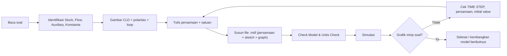

# PANDUAN VENSIM
### Dari Soal Kasus → CLD → SFD → File `.mdl` → Simulasi → Validasi

Panduan ini disusun dari pengerjaan kasus **Production and Inventory** (UTS PKTSD 2023, SFD Model 1 & Model 2). Langkah-langkahnya berlaku umum untuk kasus System Dynamics lain.

---

## Daftar Isi
1. [Alur Kerja Singkat](#1-alur-kerja-singkat)
2. [Persiapan Lingkungan](#2-persiapan-lingkungan)
3. [Langkah 1 – Membaca & Membedah Soal](#3-langkah-1--membaca--membedah-soal)
4. [Langkah 2 – Causal Loop Diagram (CLD)](#4-langkah-2--causal-loop-diagram-cld)
5. [Langkah 3 – Menyusun Persamaan SFD](#5-langkah-3--menyusun-persamaan-sfd)
6. [Langkah 4 – Menulis File `.mdl`](#6-langkah-4--menulis-file-mdl)
7. [Langkah 5 – Bagian Sketch (Diagram)](#7-langkah-5--bagian-sketch-diagram)
8. [Langkah 6 – Grafik Bawaan (Custom Graph)](#8-langkah-6--grafik-bawaan-custom-graph)
9. [Langkah 7 – Cek, Simulasi & Validasi](#9-langkah-7--cek-simulasi--validasi)
10. [Langkah 8 – Mengembangkan Model (Model 1 → Model 2)](#10-langkah-8--mengembangkan-model-model-1--model-2)
11. [Cara Membuat Model Langsung di Aplikasi Vensim](#11-cara-membuat-model-langsung-di-aplikasi-vensim)
12. [Pelajaran Penting & Jebakan Umum](#12-pelajaran-penting--jebakan-umum)
13. [Checklist Akhir](#13-checklist-akhir)
14. [Lampiran – Contoh Kasus Production & Inventory](#14-lampiran--contoh-kasus-production--inventory)

---

## 1. Alur Kerja Singkat



---

## 2. Persiapan Lingkungan

| Kebutuhan | Keterangan |
|---|---|
| **Vensim** (PLE / PLE Plus / DSS / Model Reader) | Untuk membuka & menjalankan `.mdl` secara native |
| **Python 3.10+** (opsional) | Untuk cek & simulasi tanpa Vensim memakai `vensim-skill` |
| **Skill** `.agents/skills/vensim-skill` | Berisi CLI: `doctor`, `build`, `check`, `simulate`, `preview`, dll. |

### Catatan khusus Windows (PowerShell)
- Perintah `python` bisa jadi hanya alias Microsoft Store → panggil path lengkap, contoh:
  ```powershell
  $py = "C:\Users\<user>\AppData\Local\Python\pythoncore-3.14-64\python.exe"
  ```
- CLI skill mencetak karakter Mandarin → **wajib** set UTF-8 agar tidak error `UnicodeEncodeError`:
  ```powershell
  $env:PYTHONUTF8="1"
  ```
- Contoh pemakaian:
  ```powershell
  $env:PYTHONUTF8="1"; & $py .agents/skills/vensim-skill/scripts/skill_cli.py doctor
  $env:PYTHONUTF8="1"; & $py .agents/skills/vensim-skill/scripts/skill_cli.py check  Model.mdl
  $env:PYTHONUTF8="1"; & $py .agents/skills/vensim-skill/scripts/skill_cli.py simulate Model.mdl --var Inventory --output hasil.csv
  ```
- Jika `pip install matplotlib` gagal (misal error SSL), grafik bisa dibuat dengan **Pillow (PIL)** yang biasanya sudah terpasang.

---

## 3. Langkah 1 – Membaca & Membedah Soal

Baca soal kalimat per kalimat, lalu klasifikasikan setiap elemen:

| Jenis | Ciri-ciri di soal | Contoh |
|---|---|---|
| **Stock (Level)** | Sesuatu yang *menumpuk*, punya nilai awal | Inventory, Labor |
| **Flow (Rate)** | Laju masuk/keluar stock, satuan `.../Week` | Production rate, Shipment rate, Hiring rate, Quit rate |
| **Auxiliary** | Hasil perhitungan dari variabel lain | Desired inventory, Correction for inventory |
| **Konstanta** | Angka tetap (waktu tunda, koefisien) | taor = 8, tci = 8, dic = 4, tcl = 24, ade = 50 |
| **Input eksogen** | Pola uji dari luar sistem | Order rate = `1000*(1+STEP(0.1,10))` |

**Tips menerjemahkan kalimat ke persamaan:**

| Kalimat di soal | Bentuk persamaan |
|---|---|
| "averaging past orders over an eight-week period" | `SMOOTH(Order rate, taor)` |
| "correct discrepancies ... in eight weeks" | `(Desired − Actual) / tci` |
| "four weeks' worth of anticipated shipments" | `Average order rate * dic` |
| "replace those who quit, modified by a correction" | `Quit rate + Correction for labor` |
| "workers stay an average of 50 weeks" | `Labor / ade` |
| "step up by 10% at period 10" | `1000*(1+STEP(0.1,10))` |
| "initial value equal to desired" | Nilai awal stock = kondisi ekuilibrium |

> **Kondisi awal ekuilibrium:** pilih nilai awal stock agar semua flow seimbang di t = 0.
> Contoh: Inventory₀ = 1000 × 4 = **4000**, Labor₀ = 1000 / 20 = **50**.

---

## 4. Langkah 2 – Causal Loop Diagram (CLD)

1. Tulis setiap hubungan **A → B** yang muncul di persamaan.
2. Beri polaritas:
   - **(+)** jika A naik → B naik (ceteris paribus)
   - **(−)** jika A naik → B turun
3. Identifikasi loop dan tentukan jenisnya:
   - Hitung jumlah tanda **(−)** di loop.
   - **Genap → Reinforcing (R)**, **Ganjil → Balancing (B)**.

Contoh (kasus ini):

| Loop | Jalur | Jenis |
|---|---|---|
| B1 Inventory control | Inventory →(−) Correction for inventory →(+) Desired production →(+) Production →(+) Inventory | Balancing |
| B2 Labor control | Labor →(−) Correction for labor →(+) Hiring rate →(+) Labor | Balancing |
| B3 Attrition | Labor →(+) Quit rate →(−) Labor | Balancing |

> Polaritas ditentukan dari **persamaan**, bukan dari nama variabel. Contoh: `tci` → Correction for inventory bertanda (−) karena berada di penyebut.

---

## 5. Langkah 3 – Menyusun Persamaan SFD

Untuk setiap variabel siapkan: **nama, persamaan, satuan, komentar**.

| Variabel | Persamaan | Satuan |
|---|---|---|
| Inventory | `INTEG(+Production rate − Shipment rate, 4000)` | units |
| Production rate | `Desired production rate` (Model 1) | units/Week |
| Shipment rate | `Order rate` | units/Week |
| Order rate | `1000*(1+step(0.1,10))` | units/Week |
| Average order rate | `SMOOTH(Order rate, taor)` | units/Week |
| Desired inventory | `Average order rate * dic` | units |
| Correction for inventory | `(Desired inventory − Inventory)/tci` | units/Week |
| Desired production rate | `Average order rate + Correction for inventory` | units/Week |
| taor, tci | 8 | Week |
| dic | 4 | Week |

**Cek konsistensi satuan:** flow harus bersatuan *satuan stock / waktu*.
`units / Week` ✔ — `(units − units)/Week` ✔ — `units/Week × Week = units` ✔

---

## 6. Langkah 4 – Menulis File `.mdl`

File `.mdl` adalah teks biasa dengan 3 bagian:

```
[1] Blok persamaan
[2] Blok sketch (diagram)     ← diawali  \\\---/// Sketch information ...
[3] Blok graph / setting      ← setelah  ///---\\\
```

### 6.1 Format satu persamaan

```
Nama Variabel=
	persamaan
	~	satuan
	~	komentar (boleh kosong, baris panjang disambung dengan \ )
	|
```

Contoh stock:

```
Inventory= INTEG (
	+Production rate-Shipment rate,
		4000)
	~	units
	~	The initial inventory is four weeks' worth of shipments (1,000 x 4 = 4,000)
	|
```

### 6.2 Blok kontrol simulasi (wajib)

```
********************************************************
	.Control
********************************************************~
		Simulation Control Parameters
	|

FINAL TIME  = 100
	~	Week
	~	The final time for the simulation.
	|

INITIAL TIME  = 0
	~	Week
	~	The initial time for the simulation.
	|

SAVEPER  = 
        TIME STEP
	~	Week
	~	The frequency with which output is stored.
	|

TIME STEP  = 1
	~	Week
	~	The time step for the simulation.
	|
```

> ⚠️ **TIME STEP sangat berpengaruh.** Kunci jawaban memakai `TIME STEP = 1`. Dengan 0.125 hasil Model 2 bergeser (Inventory min 2937 vs 2880). Selalu samakan TIME STEP dengan acuan/soal.

---

## 7. Langkah 5 – Bagian Sketch (Diagram)

Header sketch:

```
\\\---/// Sketch information - do not modify anything except names
V300  Do not put anything below this section - it will be ignored
*View 1
$192-192-192,0,Times New Roman|12||0-0-0|0-0-0|0-0-255|-1--1--1|-1--1--1|96,96
```

### 7.1 Jenis objek

| Kode | Objek | Format ringkas |
|---|---|---|
| `10` | Variabel (stock / aux / label flow) | `10,id,Nama,x,y,w,h,shape,3,0,0,...` |
| `11` | Valve (keran flow) | `11,id,48,x,y,6,8,34,3,0,0,1,0,0,0` |
| `12` | Cloud (sumber/akhir di luar batas sistem) | `12,id,48,x,y,10,8,0,3,0,0,-1,0,0,0` |
| `1`  | Panah (pipa / informasi) | `1,id,dari,ke,shape,...,1|(xTengah,yTengah)|` |

Nilai `shape` pada objek `10`:
- `3` = **Stock** (kotak)
- `0` = **Auxiliary/konstanta** (teks biasa)
- `32` = **Label flow** (menempel pada valve)

`x,y` = titik tengah objek; `w,h` = setengah lebar/tinggi.

### 7.2 Membuat flow (pipa)
Satu flow = **valve + label + 2 panah pipa** (+ cloud jika berbatasan dengan luar sistem):

```
12,2,48,39,114,10,8,0,3,0,0,-1,0,0,0                 ← cloud kiri
11,5,48,114,112,6,8,34,3,0,0,1,0,0,0                 ← valve
10,6,Production rate,114,131,49,11,32,3,0,0,-1,0,0,0 ← label flow
1,3,5,1,4,0,0,22,0,0,0,-1--1--1,,1|(151,112)|        ← valve → Inventory (shape 4 = ujung panah)
1,4,5,2,100,0,0,22,0,0,0,-1--1--1,,1|(78,112)|       ← valve → cloud   (shape 100 = pangkal pipa)
```

Aturan: **panah pipa selalu berasal dari valve**. `4` = ujung berpanah (arah aliran), `100` = sisi asal aliran. Nilai `22` = tebal pipa.

### 7.3 Panah informasi
```
1,20,13,12,1,0,0,0,0,0,0,-1--1--1,,1|(200,231)|
```
- `13 → 12` = dari *Correction for inventory* ke *Desired production rate*.
- `(200,231)` = titik kontrol lengkung panah.
- Panah ke flow diarahkan ke **label flow** (id label, mis. `6`) atau ke valve.

> Setiap variabel yang muncul di persamaan **harus** punya panah informasi ke variabel tujuannya. Kalau tidak, Vensim memberi peringatan saat *Check Model*.

### 7.4 Tips layout
- Stock & pipa di baris atas (Inventory) dan bawah (Labor), auxiliary di tengah.
- Letakkan konstanta (tci, dic, taor, tcl, ade) dekat variabel yang dipengaruhinya.
- Paling aman: **atur posisi langsung di Vensim**, lalu simpan; Vensim akan menulis ulang koordinat.

---

## 8. Langkah 6 – Grafik Bawaan (Custom Graph)

Setelah `///---\\\`, tambahkan grafik siap pakai:

```
:GRAPH INVENTORY
:TITLE Inventory vs Desired inventory
:SCALE
:VAR Desired inventory
:Y-MIN 2800
:Y-MAX 5200
:LINE-WIDTH 3
:VAR Inventory
:Y-MIN 2800
:Y-MAX 5200
:LINE-WIDTH 2
```

- `:SCALE` → semua variabel memakai skala Y yang sama.
- Nama di `:VAR` **harus persis** sama dengan nama variabel di model (variabel asing/tidak ada sebaiknya dihapus).
- Di Vensim: **Windows → Control Panel → Graphs** untuk membuka/mengedit grafik ini.

---

## 9. Langkah 7 – Cek, Simulasi & Validasi

### 9.1 Di Vensim
1. **Model → Check Model** (Ctrl+T) → harus "Model is OK".
2. **Model → Units Check** (Ctrl+U) → tidak ada error satuan.
3. Klik **Simulate** (ikon ▶ hijau).
4. Pilih variabel → klik **Graph** / **Causes Strip** / **Table**.

### 9.2 Tanpa Vensim (vensim-skill)
```powershell
$env:PYTHONUTF8="1"; & $py .agents/skills/vensim-skill/scripts/skill_cli.py check    Model_1_Production_Inventory.mdl
$env:PYTHONUTF8="1"; & $py .agents/skills/vensim-skill/scripts/skill_cli.py simulate Model_1_Production_Inventory.mdl --var Inventory --output results_inv.csv
```

### 9.3 Validasi perilaku
Bandingkan hasil dengan grafik di soal:

| Uji | Yang dicek |
|---|---|
| Ekuilibrium awal | Semua variabel datar pada t = 0–10 |
| Respon step | Perubahan dimulai tepat di t = 10 |
| Nilai akhir | Inventory → 4400, Production → 1100 |
| Bentuk kurva | Model 1: penyesuaian mulus; Model 2: osilasi teredam |
| Titik ekstrem | Cocokkan nilai & waktu puncak/lembah dengan grafik soal |

Jika tidak cocok, periksa berurutan: **TIME STEP → nilai awal stock → tanda/persamaan → konstanta**.

---

## 10. Langkah 8 – Mengembangkan Model (Model 1 → Model 2)

1. **Salin** file Model 1 → simpan sebagai Model 2 (jangan menimpa Model 1).
2. Tambah stock baru (**Labor**) beserta flow **Hiring rate** (masuk) dan **Quit rate** (keluar).
3. Tambah auxiliary & konstanta baru: `Desired labor`, `Correction for labor`, `Normal production rate`, `Average labor productivity = 20`, `tcl = 24`, `ade = 50`.
4. **Ubah** persamaan yang terdampak: `Production rate = Normal production rate`.
5. Hapus panah lama `Desired production rate → Production rate`, ganti `Normal production rate → Production rate`.
6. Pastikan nilai awal tetap ekuilibrium (Labor₀ = 1000/20 = 50).
7. Check → Simulasi → bandingkan.

Dampak perilaku: tunda koreksi tenaga kerja (24 minggu) menambah *phase lag* → muncul **osilasi** (Inventory turun ke ±2880 lalu overshoot ±5050).

---

## 11. Cara Membuat Model Langsung di Aplikasi Vensim

| Langkah | Menu / Tool |
|---|---|
| Model baru | **File → New Model** → isi INITIAL TIME 0, FINAL TIME 100, TIME STEP 1, Units for Time: Week |
| Stock | Tool **Box Variable – Level** → klik kanvas → ketik nama |
| Flow | Tool **Rate** → klik dari cloud/stock asal ke stock tujuan → ketik nama |
| Auxiliary/konstanta | Tool **Variable – Auxiliary/Constant** |
| Panah informasi | Tool **Arrow** → klik variabel asal lalu tujuan |
| Isi persamaan | Tool **Equations** (fx) → klik variabel → isi persamaan, satuan, komentar |
| Cek | **Model → Check Model**, **Model → Units Check** |
| Simulasi | Tombol **Simulate** |
| Grafik | Pilih variabel → **Graph**, atau buat Custom Graph di Control Panel |
| Simpan | **File → Save As** → format `.mdl` |

---

## 12. Pelajaran Penting & Jebakan Umum

| # | Masalah | Solusi |
|---|---|---|
| 1 | Hasil simulasi beda tipis dari acuan | Samakan **TIME STEP** (kasus ini: 1) dan `SAVEPER = TIME STEP` |
| 2 | Model tidak mulai ekuilibrium | Hitung ulang nilai awal stock dari kondisi steady-state |
| 3 | Peringatan "variable not used / missing arrow" | Tambahkan panah informasi untuk setiap variabel di persamaan |
| 4 | Pipa flow terbalik arah | Ujung `shape 4` = tujuan aliran, `shape 100` = asal aliran |
| 5 | Grafik bawaan error | Hapus `:VAR` yang namanya tidak ada di model |
| 6 | Sketch header ganda / rusak | Hanya boleh satu baris `\\\---/// Sketch information ...` |
| 7 | `SMOOTH` vs `DELAY` | Peramalan/rata-rata informasi → `SMOOTH`; keterlambatan material → `DELAY1/DELAY3` |
| 8 | `STEP` | `STEP(tinggi, waktu)` → bernilai 0 sebelum *waktu*, lalu *tinggi* |
| 9 | CLI Python error encoding di Windows | `$env:PYTHONUTF8="1"` |
| 10 | Nama variabel | Konsisten persis (huruf besar/kecil & spasi) di persamaan, sketch, dan graph |

---

## 13. Checklist Akhir

- [ ] Semua stock punya `INTEG(inflow − outflow, nilai awal)`
- [ ] Semua variabel punya satuan & komentar
- [ ] INITIAL TIME, FINAL TIME, TIME STEP, SAVEPER sesuai soal
- [ ] Model mulai dalam ekuilibrium
- [ ] Check Model & Units Check lolos
- [ ] Setiap dependensi persamaan punya panah di diagram
- [ ] Layout diagram mirip SFD di soal
- [ ] Grafik simulasi mirip grafik di soal
- [ ] CLD lengkap dengan polaritas & label loop (R/B)
- [ ] File disimpan terpisah per model (Model 1, Model 2)

---

## 14. Lampiran – Contoh Kasus Production & Inventory

**File hasil:**
- [Model_1_Production_Inventory.mdl](Model_1_Production_Inventory.mdl)
- [Model_2_Production_Inventory_Labor.mdl](Model_2_Production_Inventory_Labor.mdl)
- Acuan: `UTS PKTSD (S) 2023 SFD1 Answer.mdl`, `UTS PKTSD (S) 2023 SFD2 Answer.mdl`
- Grafik: `sfd_model_1_simulation_graph.png`, `sfd_model_2_simulation_graph.png`

**Persamaan tambahan Model 2:**

| Variabel | Persamaan | Satuan |
|---|---|---|
| Labor | `INTEG(+Hiring rate − Quit rate, 50)` | person |
| Hiring rate | `Quit rate + Correction for labor` | person/Week |
| Quit rate | `Labor / ade` | person/Week |
| Correction for labor | `(Desired labor − Labor)/tcl` | person/Week |
| Desired labor | `Desired production rate / Average labor productivity` | person |
| Normal production rate | `Labor * Average labor productivity` | units/Week |
| Production rate | `Normal production rate` | units/Week |
| ade / tcl | 50 / 24 | Week |
| Average labor productivity | 20 | units/person/Week |

**Ringkasan hasil (TIME STEP = 1):**

| Indikator | Model 1 | Model 2 |
|---|---|---|
| Perilaku | Penyesuaian mulus (goal-seeking) | Osilasi teredam |
| Inventory minimum | ±3780 (minggu ±15) | ±2880 (minggu ±28) |
| Inventory maksimum | → 4400 (tanpa overshoot) | ±5049 (minggu ±73) |
| Puncak Production rate | ±1129 (minggu ±23) | ±1177 (minggu ±47) |
| Puncak Desired production | = Production rate | ±1278 (minggu ±30) |
