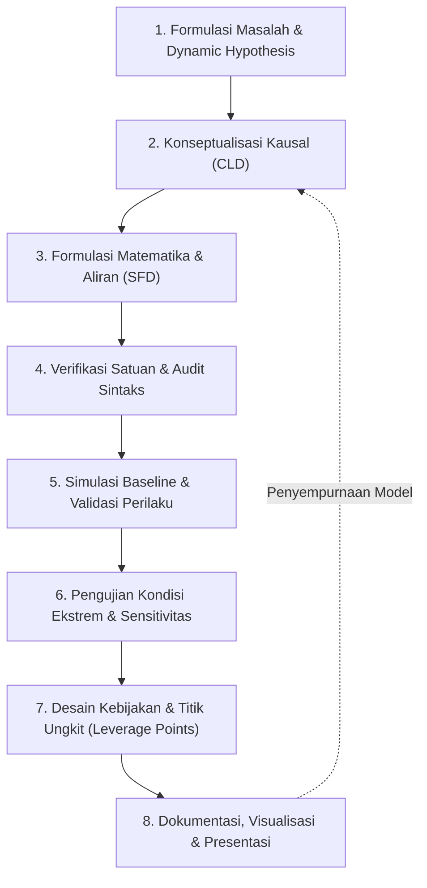

# MASTER STANDARD OPERATING PROCEDURE (SOP) & PANDUAN LENGKAP
# PEMODELAN SISTEM DINAMIK DENGAN VENSIM
## Dari Formulasi Masalah, Rekayasa Struktur Kausal, Verifikasi Matematis, hingga Pengujian Kebijakan

---

## DAFTAR ISI
1. [Filosofi & Kerangka Kerja Berpikir Sistem (*System Thinking Framework*)](#1-filosofi--kerangka-kerja-berpikir-sistem-system-thinking-framework)
2. [Tahap 1: Artikulasi Masalah & Batasan Sistem (*System Boundary*)](#2-tahap-1-artikulasi-masalah--batasan-sistem-system-boundary)
3. [Tahap 2: Perancangan Diagram Sebab-Akibat (*Causal Loop Diagram* / CLD)](#3-tahap-2-perancangan-diagram-sebab-akibat-causal-loop-diagram--cld)
4. [Tahap 3: Perancangan Diagram Stok dan Aliran (*Stock and Flow Diagram* / SFD)](#4-tahap-3-perancangan-diagram-stok-dan-aliran-stock-and-flow-diagram--sfd)
5. [Tahap 4: Disiplin Persamaan Matematis & Konsistensi Satuan (*Unit Balance*)](#5-tahap-4-disiplin-persamaan-matematis--konsistensi-satuan-unit-balance)
6. [Tahap 5: Konfigurasi Kontrol Simulasi & Algoritma Numerik](#6-tahap-5-konfigurasi-kontrol-simulasi--algoritma-numerik)
7. [Tahap 6: Arsitektur File Native MDL Vensim & Rekayasa Visual Diagram](#7-tahap-6-arsitektur-file-native-mdl-vensim--rekayasa-visual-diagram)
8. [Tahap 7: Protokol Verifikasi Sintaks & Eliminasi Kesalahan Pemodelan](#8-tahap-7-protokol-verifikasi-sintaks--eliminasi-kesalahan-pemodelan)
9. [Tahap 8: Pengujian Ketahanan & Validasi Struktur Model (*Model Testing*)](#9-tahap-8-pengujian-ketahanan--validasi-struktur-model-model-testing)
10. [Tahap 9: Analisis Perilaku Dasar Melintasi Waktu (*Behavior Over Time* / BOT)](#10-tahap-9-analisis-perilaku-dasar-melintasi-waktu-behavior-over-time--bot)
11. [Tahap 10: Perancangan Skenario, Matriks Kebijakan & Uji Resistensi](#11-tahap-10-perancangan-skenario-matriks-kebijakan--uji-resistensi)
12. [Tahap 11: Cetak Biru Presentasi Eksekutif & Pelaporan Strategis](#12-tahap-11-cetak-biru-presentasi-eksekutif--pelaporan-strategis)
13. [Matriks Checklist Final Pra-Pengumpulan / Pra-Deployment](#13-matriks-checklist-final-pra-pengumpulan--pra-deployment)

---

## 1. FILOSOFI & KERANGKA KERJA BERPIKIR SISTEM (*SYSTEM THINKING FRAMEWORK*)

### 1.1 Prinsip Fundamental: Struktur Mengendalikan Perilaku (*Structure Drives Behavior*)
Inti dari metodologi Sistem Dinamik (*System Dynamics*) adalah pemahaman bahwa pola perilaku dinamis suatu sistem yang terjadi melintasi waktu (*behavior over time*) tidak disebabkan oleh guncangan eksternal semata, melainkan merupakan manifestasi langsung dari struktur umpan balik (*feedback structure*), penumpukan/akumulasi (*stocks*), dan keterlambatan informasi/materiil (*delays*) yang saling terikat di dalam sistem itu sendiri.

### 1.2 Pendekatan Berpikir Endogen (*Endogenous Perspective*)
Dalam menganalisis fenomena apa pun, selalu prioritaskan penjelasan endogen:
* Jangan mengandalkan variabel eksogen tak terkendali sebagai kambing hitam kegagalan sistem.
* Bangun loop umpan balik tertutup (*closed-loop feedback*) di mana tindakan pengambilan keputusan menghasilkan konsekuensi yang pada akhirnya kembali mempengaruhi keputusan tersebut di masa berikutnya.

### 1.3 Alur Kerja Pemodelan Siklis (*Iterative Modeling Cycle*)



---

## 2. TAHAP 1: ARTIKULASI MASALAH & BATASAN SISTEM (*SYSTEM BOUNDARY*)

Sebelum menggambar satu pun diagram, tetapkan batasan eksplisit dari persoalan yang akan diselesaikan.

### 2.1 Identifikasi Hipotesis Dinamis (*Dynamic Hypothesis*)
* Nyatakan secara tertulis: **Pola perilaku masalah apa yang sedang terjadi, mengapa hal itu terjadi berulang kali, dan struktur umpan balik apa yang diduga menjadi pemicu utamanya?**
* Petakan pola referensi historis (*Reference Mode of Behavior*): Buat sketsa kurva kasar bagaimana variabel kunci bergerak di masa lampau dan bagaimana kecenderungannya di masa depan jika dibiarkan tanpa intervensi.

### 2.2 Klasifikasi Variabel Batas Sistem (*System Boundary Chart*)
Bagi seluruh variabel ke dalam tiga kategori ketat:
1. **Variabel Endogen (*Endogenous*)**: Variabel yang nilainya dihitung, dipengaruhi, dan mempengaruhi variabel lain di dalam struktur model (bagian dari loop umpan balik).
2. **Variabel Eksogen (*Exogenous*)**: Variabel pemicu eksternal yang mempengaruhi model namun tidak dipengaruhi balik oleh model. Batasi jumlah variabel ini seminimal mungkin.
3. **Variabel yang Dikecualikan (*Excluded*)**: Faktor-faktor nyata di lapangan yang sengaja diabaikan untuk menjaga kesederhanaan model (*parsimony*) karena tidak relevan secara signifikan terhadap tujuan masalah.

### 2.3 Penetapan Horizon Waktu (*Time Horizon*) & Satuan Waktu
* **Horizon Waktu**: Harus cukup panjang untuk memperlihatkan pembentukan penumpukan (*stocks*), munculnya penundaan (*delays*), dan pergantian dominasi loop (*loop dominance shift*). Aturan praktis: minimal 2 hingga 3 kali siklus alami terpanjang dalam sistem.
* **Satuan Waktu (*Time Units*)**: Pilih satuan waktu standar yang konsisten di seluruh model (misalnya: `Second`, `Minute`, `Hour`, `Day`, `Week`, `Month`, atau `Year`). Seluruh variabel laju (*rate/flow*) wajib merujuk pada satuan waktu dasar ini.

---

## 3. TAHAP 2: PERANCANGAN DIAGRAM SEBAB-AKIBAT (*CAUSAL LOOP DIAGRAM* / CLD)

CLD bertujuan menangkap peta hubungan sebab-akibat antar-variabel secara kualitatif sebelum masuk ke persamaan komputasi.

### 3.1 Aturan Penamaan Variabel CLD
1. Gunakan **kata benda** atau frasa kata benda (*noun phrase*), bukan kata kerja. (Contoh: gunakan `Laju Pertambahan`, bukan `Menambah`).
2. Gunakan orientasi makna positif. (Contoh: gunakan `Tingkat Kualitas`, bukan `Ketidakberesan`).
3. Pastikan kuantitas variabel dapat dibayangkan naik atau turun secara logis.

### 3.2 Menentukan Polaritas Panah Sebab-Akibat (*Link Polarity*)
Setiap panah yang menghubungkan Sebab ($X$) ke Akibat ($Y$) wajib memiliki polaritas tegas:

$$\text{Tanda Polaritas} = \text{Sign}\left(\frac{\partial Y}{\partial X}\right)$$

* **Polaritas Positif ($+$)**: Perubahan pada $X$ menyebabkan perubahan pada $Y$ dengan **arah yang sama** (jika $X$ meningkat maka $Y$ meningkat di atas kondisi seharusnya; jika $X$ menurun maka $Y$ menurun di bawah kondisi seharusnya).
* **Polaritas Negatif ($-$)**: Perubahan pada $X$ menyebabkan perubahan pada $Y$ dengan **arah yang berlawanan** (jika $X$ meningkat maka $Y$ menurun di bawah kondisi seharusnya; jika $X$ menurun maka $Y$ meningkat di atas kondisi seharusnya).

### 3.3 Kaidah Pelabelan dan Penetapan Polaritas Loop Umpan Balik
Loop umpan balik adalah lintasan tertutup yang bermula dan berakhir pada variabel yang sama tanpa melewati variabel mana pun lebih dari satu kali.

$$\text{Polaritas Loop} = \prod_{i=1}^{n} (\text{Polaritas Panah}_i)$$

1. **Loop Penguatan (*Reinforcing Loop* / $R$ atau $+$)**:
   - Jumlah tanda negatif ($-$) di sepanjang lintasan tertutup bernilai **NOL** atau **GENAP**.
   - Menghasilkan perilaku pertumbuhan eksponensial (*exponential growth*), pemburukan beruntun (*vicious cycle*), atau perbaikan bertingkat (*virtuous cycle*).
   - Beri kode terurut: $R1, R2, R3, \dots$
2. **Loop Penyeimbang (*Balancing Loop* / $B$ atau $-$)**:
   - Jumlah tanda negatif ($-$) di sepanjang lintasan tertutup bernilai **GANJIL**.
   - Menghasilkan perilaku pencarian target (*goal-seeking*), stabilisasi, resistensi, atau osilasi teredam.
   - Beri kode terurut: $B1, B2, B3, \dots$

### 3.4 Identifikasi Pola Arketipe Sistem (*System Archetypes*)
Periksa apakah kombinasi loop membentuk pola arketipe klasik:
* **Limits to Growth**: Loop Penguatan ($R$) yang semula tumbuh pesat akhirnya terhambat dan mendatar oleh Loop Penyeimbang ($B$) akibat keterbatasan kapasitas.
* **Shifting the Burden**: Solusi simtomatik cepat membentuk loop penyeimbang jangka pendek, namun melemahkan kemampuan solusi fundamental jangka panjang.
* **Tragedy of the Commons**: Beberapa aktor independen memacu loop penguatan masing-masing untuk mengeksploitasi sumber daya bersama, hingga loop penyeimbang kapasitas terpicu secara terlambat dan menghancurkan seluruh sistem.
* **Fixes that Fail**: Tindakan perbaikan cepat justru memicu konsekuensi tak terduga (*unintended consequences*) yang memperparah masalah awal.

---

## 4. TAHAP 3: PERANCANGAN DIAGRAM STOK DAN ALIRAN (*STOCK AND FLOW DIAGRAM* / SFD)

CLD memberikan intuisi kausal, tetapi tidak dapat disimulasikan secara numerik karena tidak membedakan antara akumulasi fisik dan laju perubahan. SFD memisahkan keduanya secara presisi.

```
                  Inflow                          Outflow
 [Cloud: Sumber] ======> [ VALVE ] ======> [ STOCK ] ======> [ VALVE ] ======> [Cloud: Muara]
                            ^                 |                 ^
                            |                 |                 |
                   [Auxiliary A] <------------+--------- [Auxiliary B]
```

### 4.1 Taksonomi 4 Jenis Variabel SFD
1. **Stock (Level / Akumulasi)**:
   - Entitas fisik atau informasi yang terakumulasi melintasi waktu.
   - Memiliki memori; nilainya tidak hilang seketika jika aliran berhenti.
   - Diuji dengan *Snapshot Test*: Jika waktu dibekukan sesaat, stok adalah variabel yang masih memiliki besaran fisik nyata (misalnya: volume air dalam tangki, jumlah saldo, jumlah unit).
2. **Flow (Rate / Laju Perubahan)**:
   - Tindakan atau proses yang menambah (*inflow*) atau mengurangi (*outflow*) stok per satuan waktu.
   - Diuji dengan *Snapshot Test*: Jika waktu dibekukan, laju seketika bernilai nol (misalnya: laju pengisian per menit, laju konsumsi per hari).
3. **Auxiliary (Variabel Pembantu / Konverter)**:
   - Menampung kalkulasi antara, parameter gabungan, logika keputusan, atau formulasi aljabar untuk menyederhanakan perhitungan aliran.
   - Tidak memiliki memori; nilainya dihitung ulang seketika pada setiap *time step*.
4. **Constant (Parameter Konstan)**:
   - Nilai tetap yang mencerminkan karakteristik fisik, kebijakan statis, atau asumsi dasar lingkungan (misalnya: daya tampung maksimum, tarif biaya, proporsi fraksional).

### 4.2 Aturan Baku Penempatan Stok dan Katup
* **Pipa Aliran Wajib Memiliki Katup (*Valve*)**: Setiap aliran masuk dan aliran keluar harus dikendalikan oleh satu katup yang menjadi representasi fungsi persamaan laju.
* **Sumber dan Muara Tak Hingga (*Clouds*)**: Jika materi datang dari luar batas sistem yang diamati, hubungkan pipa masuk dari awan sumber (*source cloud*). Jika materi keluar melampaui batas pengamatan sistem, hubungkan pipa keluar menuju awan muara (*sink cloud*).
* **Larangan Menghubungkan Flow Langsung ke Flow**: Aliran tidak boleh mengalir langsung ke aliran lain tanpa melalui penampungan stok.

---

## 5. TAHAP 4: DISIPLIN PERSAMAAN MATEMATIS & KONSISTENSI SATUAN (*UNIT BALANCE*)

Model yang benar secara konsep matematika wajib lulus uji konsistensi dimensi (*dimensional consistency test*).

### 5.1 Rumus Baku Integrasi Stok
Di Vensim, stok selalu dan hanya didefinisikan melalui fungsi integral `INTEG`:

$$\text{Stock}(t) = \text{Stock}(t_0) + \int_{t_0}^{t} \left(\sum \text{Inflows}(\tau) - \sum \text{Outflows}(\tau)\right) d\tau$$

Format sintaks Vensim:
```text
Stock Name = INTEG (
    + Inflow_1 + Inflow_2 - Outflow_1 - Outflow_2,
        Initial_Value)
    ~ Unit_Of_Stock
    ~ Penjelasan variabel stok |
```

### 5.2 Kaidah Keseimbangan Dimensi Satuan (*Dimensional Balance Law*)
Wajib mematuhi hukum turunan kalkulus:

$$\text{Dimensi}(\text{Flow}) = \frac{\text{Dimensi}(\text{Stock})}{\text{Dimensi}(\text{Waktu Simulasi})}$$

* Contoh: Jika `Stock` bersatuan `Unit`, maka seluruh `Inflow` dan `Outflow` wajib bersatuan `Unit/Time`.
* Jika persamaan mengalikan variabel, dimensinya dikalikan: $\text{Unit}(A \times B) = \text{Unit}(A) \times \text{Unit}(B)$.
* Jika persamaan membagi variabel, dimensinya dibagi: $\text{Unit}(A / B) = \text{Unit}(A) / \text{Unit}(B)$.
* Suku-suku yang dijumlahkan atau dikurangkan wajib memiliki dimensi yang persis sama.

### 5.3 Standarisasi Variabel Nirdimensi (`Dmnl`)
Gunakan satuan `Dmnl` (*Dimensionless*) hanya untuk:
1. Rasio murni tak bersatuan: $\frac{\text{Kapasitas Terpakai}}{\text{Kapasitas Total}}$ (keduanya bersatuan sama sehingga saling membatalkan).
2. Faktor fraksional/persentase murni tanpa dimensi waktu (misalnya: elastisitas).
3. Indeks acuan normalisasi yang disetel bernilai $1.0$ pada kondisi dasar.

### 5.4 Formulasi Fungsi Keputusan & Pola Matematis Standar Vensim

| Kebutuhan Dinamis | Format Persamaan Resmi Vensim | Keterangan & Penggunaan |
| :--- | :--- | :--- |
| **Logika Percabangan** | `IF THEN ELSE(Kondisi, Nilai_Benar, Nilai_Salah)` | Evaluasi logika biner untuk aktivasi aturan atau kuota batas |
| **Guncangan Bertahap** | `Nilai_Dasar * (1 + STEP(Ketinggian, Waktu_Mulai))` | Memberikan kenaikan permanen instan pada waktu tertentu |
| **Tren Linear Bertahap** | `Nilai_Awal + RAMP(Kemiringan, Waktu_Mulai, Waktu_Selesai)` | Mensimulasikan kemajuan teknologi atau depresiasi bertahap |
| **Guncangan Sesaat** | `PULSE(Waktu_Mulai, Durasi)` | Mensimulasikan interupsi singkat (misalnya bencana alam) |
| **Penghalusan Informasi** | `SMOOTH(Variabel_Input, Waktu_Penghalusan)` | Filter keterlambatan persepsi (*First-Order Exponential Delay*) |
| **Penundaan Materiil** | `DELAY1(Aliran_Masuk, Waktu_Tunda)` atau `DELAY3(...)` | Mensimulasikan jeda transit logistik atau waktu tunggu proses |
| **Fluktuasi Acak Normal** | `RANDOM NORMAL(Batas_Bawah, Batas_Atas, Rata2, StdDev, Seed)` | Mensimulasikan noise/cuaca/variasi lingkungan terkontrol |
| **Pertumbuhan Logistik** | `Laju_Maks * Stok * (1 - (Stok / Daya_Dukung))` | Menjaga biomassa atau adopsi pasar agar tidak melampaui kapasitas |

---

## 6. TAHAP 5: KONFIGURASI KONTROL SIMULASI & ALGORITMA NUMERIK

Blok `.Control` mengatur mesin kalkulasi numerik diferensial Vensim.

```text
********************************************************
	.Control
********************************************************~
		Simulation Control Parameters
	|

FINAL TIME  = 100
	~	Time_Unit
	~	Waktu akhir simulasi.
	|

INITIAL TIME  = 0
	~	Time_Unit
	~	Waktu awal simulasi.
	|

SAVEPER  = 
        TIME STEP
	~	Time_Unit [0,?]
	~	Frekuensi pencatatan data ke memori/file.
	|

TIME STEP  = 0.0625
	~	Time_Unit [0,?]
	~	Langkah integrasi komputasi numerik.
	|
```

### 6.1 Kaidah Penetapan `TIME STEP` ($dt$)
Penetapan langkah waktu ($dt$) yang salah dapat menyebabkan kesalahan numerik (*numerical artifacts*) atau osilasi fiktif.
* **Aturan Emas**: $dt$ harus bernilai $\le \frac{1}{4}$ hingga $\frac{1}{8}$ dari konstanta waktu terkecil (*shortest time constant*) atau penundaan terpendek (*shortest delay*) di seluruh model.
* Gunakan pecahan biner pangkat dua untuk presisi biner komputer:
  - $1$
  - $0.5$ ($1/2$)
  - $0.25$ ($1/4$)
  - $0.125$ ($1/8$)
  - $0.0625$ ($1/16$)
  - $0.03125$ ($1/32$)

### 6.2 Pemilihan Metode Integrasi Numerik
1. **Euler Method (Default)**:
   - Integrasi persegi bertahap: $\text{Stok}(t + dt) = \text{Stok}(t) + dt \times \text{NetFlow}(t)$.
   - Cepat, stabil untuk model tanpa osilasi frekuensi tinggi, dan paling intuitif dipahami untuk keperluan manajerial.
2. **Runge-Kutta (RK4 / Diff)**:
   - Digunakan bila model memiliki komponen non-linear tajam atau frekuensi osilasi tinggi yang menuntut presisi orde-4.

---

## 7. TAHAP 6: ARSITEKTUR FILE NATIVE MDL VENSIM & REKAYASA VISUAL DIAGRAM

File `.mdl` adalah file teks biasa dengan standar ASCII/UTF-8 yang terdiri atas bagian persamaan di atas dan bagian sketsa visual (*Sketch information*) di bawah.

### 7.1 Pembatas Bagian Wajib
Bagian persamaan dan sketsa dipisahkan oleh tanda pembatas resmi:
```text
\\\---/// Sketch information - do not modify anything except names
V300  Do not put anything below this section - it will be ignored
*View 1
```

### 7.2 Anatomi Format Sketsa (*View Elements*)
Setiap elemen grafis pada kanvas didefinisikan oleh satu baris format numerik:

1. **Variabel Teks / Aux / Constant (Tipe 10)**:
   `10, ID, Nama_Variabel, PosX, PosY, Lebar, Tinggi, FontProps, ShapeProps, ...`
2. **Stok Kotak (Tipe 10 dengan Shape Level)**:
   Kotak persegi panjang mengelilingi nama stok.
3. **Katup Aliran (Tipe 11)**:
   `11, ID, 0, PosX, PosY, Lebar, Tinggi, ...` (Simbol dua segitiga berhadapan).
4. **Awan / Komentar / Label Loop (Tipe 12)**:
   `12, ID, 48, PosX, PosY, ...` untuk awan sumber/muara; atau teks bebas untuk penanda loop seperti `R1`, `B1`.
5. **Panah / Pipa Aliran (Tipe 1)**:
   `1, ID_Garis, ID_Asal, ID_Tujuan, TipePanah, ..., TitikLengkungX, TitikLengkungY`
   - Polaritas panah pada CLD dikodekan pada field atribut:
     - `43` = Tanda Positif ($+$)
     - `45` = Tanda Negatif ($-$)

### 7.3 Kaidah Estetika Tata Letak (*Layout & Clean Diagram Principles*)
1. **Aliran Utama Horizontal / Vertikal Bersih**: Letakkan pipa stok dan aliran utama secara lurus tanpa belokan tajam.
2. **Panah Informasi Melengkung Anggun**: Lengkungkan panah penghubung auxiliary agar tidak menabrak kotak stok atau memotong katup.
3. **Penempatan Label Loop di Pusat Rotasi**: Posisikan penanda loop ($R1, B1, \dots$) tepat di tengah area pusaran kausalitas.
4. **Kontras Warna & Keterbacaan**: Pastikan ukuran font proporsional (Times New Roman atau Arial ukuran 10-12 pt).

---

## 8. TAHAP 7: PROTOKOL VERIFIKASI SINTAKS & ELIMINASI KESALAHAN PEMODELAN

Sebelum menjalankan simulasi, lakukan audit berjenjang untuk memastikan bebas dari cacat matematis.

### 8.1 Matriks Audit Kesalahan Umum Vensim

| Gejala Error Vensim | Penyebab Teknis | Solusi Perbaikan |
| :--- | :--- | :--- |
| **Simultaneous equations detected / Circular loop** | Terjadi lingkaran ketergantungan aljabar langsung antar variabel auxiliary tanpa diselingi oleh Stok (*Stock*). | Sisipkan penundaan (*delay/smooth*) atau ubah salah satu variabel perantara menjadi akumulasi stok. |
| **Unit error / Dimensional inconsistency** | Satuan sisi kiri persamaan tidak sama dengan hasil operasi satuan di sisi kanan. | Kalibrasi ulang persamaan; tambahkan variabel konstanta konverter satuan jika diperlukan. |
| **Variable undefined in model** | Nama variabel yang dipanggil dalam rumus memiliki salah ketik (*typo*) atau belum digambar di diagram. | Sesuaikan ejaan huruf besar/kecil (*case-sensitive*) secara identik dengan definisi variabel. |
| **Floating point overflow / Numerical explosion** | Nilai melesat ke tak hingga akibat pembagian dengan nol atau $dt$ yang terlalu besar. | Lindungi pembagian dengan `MAX(1e-6, Pembagi)` dan perkecil nilai `TIME STEP` ($dt$). |
| **Duplicate variable definition** | Variabel yang sama didefinisikan dua kali di dalam blok persamaan. | Hapus salah satu definisi duplikat dan pastikan satu variabel hanya memiliki satu persamaan tunggal. |

---

## 9. TAHAP 8: PENGUJIAN KETAHANAN & VALIDASI STRUKTUR MODEL (*MODEL TESTING*)

Validasi model sistem dinamik **bukan** mencocokkan ramalan masa depan secara sempurna, melainkan menguji apakah struktur internal mampu merespons berbagai tekanan secara logis sesuai hukum realitas.

### 9.1 Uji Kondisi Ekstrem (*Extreme Conditions Test*)
Uji perilaku model pada batas-batas ekstrem:
1. **Stok Nol**: Set nilai awal stok menjadi $0$. Apakah laju pengeluaran otomatis menjadi nol? (Sistem nyata tidak boleh mengeluarkan materi yang tidak ada).
2. **Input Nol**: Set parameter input utama menjadi $0$. Apakah sistem mencapai ekuilibrium stabil tanpa crash?
3. **Kapasitas Nol atau Tak Hingga**: Set daya dukung menuju batas bawah dan batas atas. Apakah laju adaptasi merespons secara rasional?

### 9.2 Uji Sensitivitas Langkah Integrasi (*Time Step Sensitivity Test*)
* Jalankan model dengan $dt$ standar (misalnya $0.0625$).
* Jalankan kembali model dengan separuh dari $dt$ tersebut ($dt = 0.03125$).
* **Kriteria Kelulusan**: Trajektori grafik kedua simulasi harus berhimpit hampir sempurna. Jika grafik berubah drastis atau terjadi pergeseran fase osilasi, maka $dt$ awal terlalu besar dan wajib diperkecil.

### 9.3 Uji Konsistensi Nilai Awal (*Steady-State Equilibrium Test*)
* Atur seluruh laju masuk sama persis dengan laju keluar ($\sum \text{Inflows} = \sum \text{Outflows}$).
* Jalankan simulasi.
* **Kriteria Kelulusan**: Seluruh kurva stok harus berupa garis lurus horizontal sempurna sepanjang horizon waktu. Setiap deviasi menunjukkan adanya kebocoran matematis pada struktur.

---

## 10. TAHAP 9: ANALISIS PERILAKU DASAR MELINTASI WAKTU (*BEHAVIOR OVER TIME* / BOT)

Simulasi pertama tanpa intervensi kebijakan disebut **Skenario Baseline (Status Quo)**.

### 10.1 Taksonomi Pola Perilaku Dinamis Dasar

```
1. Pertumbuhan Eksponensial       2. Pencarian Target (Goal Seeking)
       /                                  -------- (Target)
      /                                  /
     /                                  /
    /                                  /

3. Osilasi (Siklis)              4. Kurva S (S-Shaped Growth)
       /\    /\    /\                     -------- (Kapasitas Maks)
      /  \  /  \  /  \                   /
     /    \/    \/    \              ---/

5. Melampaui Batas & Runtuh (Overshoot and Collapse)
        /\
       /  \
      /    \
     /      \___________ (Kapasitas Terdegradasi)
```

### 10.2 Analisis Pergeseran Dominasi Loop (*Loop Dominance Shift*)
Identifikasi titik belok (*inflection point*) pada kurva BOT:
* Pada fase awal, loop mana yang memegang kendali dominan? (Misalnya: $R1$ memicu pertumbuhan pesat).
* Kapan dan mengapa loop lain mengambil alih? (Misalnya: setelah waktu $t^*$, stok mendekati batas, loop penyeimbang $B1$ aktif dan menekan pertumbuhan hingga laju melambat).

---

## 11. TAHAP 10: PERANCANGAN SKENARIO, MATRIKS KEBIJAKAN & UJI RESISTENSI

Model yang telah tervalidasi digunakan sebagai laboratorium uji kebijakan tanpa risiko (*virtual management flight simulator*).

### 11.1 Format Baku Tabel Kondisi Skenario (*Scenario Conditions Table*)
Setiap perbandingan skenario wajib didefinisikan ke dalam tabel matriks parameter yang terukur:

| Kode Skenario | Nama Skenario | Deskripsi Asumsi Realitas | Parameter / Struktur yang Dimodifikasi | Tujuan Pengujian |
| :---: | :--- | :--- | :--- | :--- |
| **S0** | **Baseline (Status Quo)** | Kondisi sistem berjalan saat ini tanpa intervensi baru. | Seluruh parameter berada pada nilai standar acuan. | Tolok ukur (*benchmark*) dasar performa sistem. |
| **S1** | **Stress / Adverse Shock** | Terjadi pemburukan kondisi lingkungan eksternal (misal kenaikan biaya, penurunan harga). | Parameter eksogen diset pada batas ekstrem merugikan. | Menguji daya tahan sistem (*resilience*) terhadap krisis. |
| **S2** | **Aggressive Expansion** | Penerapan stimulus berlebihan tanpa regulasi pengaman. | Peningkatan kapasitas atau pemotongan hambatan secara drastis. | Memeriksa potensi terjadinya *Tragedy of the Commons* atau kelebihan kapasitas. |
| **S3** | **Single Policy Intervention** | Kebijakan intuitif tunggal yang biasa diambil pembuat keputusan. | Mengubah satu variabel kebijakan (misal hanya membatasi kapasitas). | Menunjukkan kelemahan intervensi tunggal akibat resistensi sistem. |
| **S4** | **Robust Policy Mix** | Kombinasi paket kebijakan struktural dan kuota adaptif. | Penggabungan batas kuota izin, regulasi laju, dan insentif ekonomi. | Menghasilkan stabilitas jangka panjang yang berkelanjutan. |

---

### 11.2 Format Baku Tabel Dampak Kebijakan (*Impact Table / Policy Performance Matrix*)
Evaluasi hasil akhir simulasi pada horizon waktu akhir ($t = \text{FINAL TIME}$) serta titik-titik kritis sistem:

| Indikator Kinerja Kunci (KPI) | Satuan | S0: Baseline | S1: Shock Ekstrem | S2: Ekspansi Agresif | S4: Robust Policy Mix (Rekomendasi) |
| :--- | :---: | :---: | :---: | :---: | :---: |
| **Stok Utama (Nilai Akhir)** | `Unit` | $X_0$ | $X_1$ | $X_2$ | $\mathbf{X_4}$ |
| **Titik Terendah Stok (*Minimum Level*)** | `Unit` | $M_0$ | $M_1$ (Kritis) | $M_2$ | $\mathbf{M_4}$ (Aman) |
| **Kapasitas / Ukuran Aktor** | `Unit` | $A_0$ | $A_1$ | $A_2$ (Overkapasitas) | $\mathbf{A_4}$ (Optimal) |
| **Output / Aliran Bersih Tahunan** | `Unit/Time` | $O_0$ | $O_1$ | $O_2$ | $\mathbf{O_4}$ |
| **Kinerja Ekonomi / Efisiensi** | `%` atau `Dmnl` | $E_0$ | $E_1$ | $E_2$ | $\mathbf{E_4}$ |
| **Status Stabilitas Sistem** | Kualitatif | Statis/Mati | Runtuh/Kolaps | Osilasi Tajam | **Stabil & Berkelanjutan** |

---

### 11.3 Identifikasi Resistensi Kebijakan (*Policy Resistance*) & Titik Ungkit (*Leverage Points*)
* **Resistensi Kebijakan**: Seringkali kebijakan yang tampak "jelas dan mudah" gagal total karena loop penyeimbang sistem melakukan kompensasi balik (*compensating feedback*).
* **Mencari Titik Ungkit Efektif (*High-Leverage Policies*)**:
  - Hindari sekadar menggeser angka parameter statis.
  - Ubah struktur aliran informasi: buat informasi penundaan menjadi instan.
  - Tambahkan loop penyeimbang baru yang mengatur kapasitas sebelum menyentuh batas fisik.
  - Ubah aturan insentif dan sanksi (*rules of the system*).

---

## 12. TAHAP 11: CETAK BIRU PRESENTASI EKSEKUTIF & PELAPORAN STRATEGIS

Saat mempresentasikan hasil pemodelan kepada pengambil keputusan, gunakan alur komunikasi deduktif yang terstruktur dalam 10 slide inti:

### Cetak Biru 10-Slide Presentasi Manajerial

* **Slide 1: Judul & Pernyataan Mandat**
  - Judul proyek yang berorientasi hasil, identitas tim konsultan/peneliti, institusi, dan horizon evaluasi.
* **Slide 2: Masalah Inti & Gejala Dinamis (*The Dynamic Problem*)**
  - Tampilkan grafik perilaku historis yang bermasalah (*Reference Mode*). Paparkan dilema utama yang dihadapi organisasi.
* **Slide 3: Peta Umpan Balik Kausal (CLD)**
  - Tampilkan diagram CLD bersih. Jelaskan konflik antar loop penguatan ($R$) dan penyeimbang ($B$). Tunjukkan akar struktural masalah.
* **Slide 4: Arsitektur Model Fisik (SFD) & Mekanisme Kunci**
  - Paparkan integrasi stok dan aliran utama. Jelaskan persamaan perilaku penentu keputusan secara intuitif tanpa membebani audiens dengan rumus teknis yang rumit.
* **Slide 5: Validasi & Pengujian Ketahanan Model**
  - Tunjukkan bukti bahwa model lulus uji kondisi ekstrem dan uji kestabilan integrasi numerik, sehingga dapat dipercaya sebagai basis keputusan.
* **Slide 6: Analisis Skenario Baseline (Status Quo)**
  - Tampilkan grafik BOT hasil simulasi kondisi saat ini. Tunjukkan ke mana arah sistem jika tidak ada intervensi (bahaya laten jangka panjang).
* **Slide 7: Matriks Kondisi Skenario Eksplorasi**
  - Paparkan Tabel Kondisi Skenario (S0 hingga S4). Jelaskan asumsi di balik setiap pengujian kebijakan.
* **Slide 8: Komparasi Trajektori Antar-Skenario**
  - Tampilkan grafik perbandingan multi-kurva berwarna kontras. Bandingkan secara visual dampak dari masing-masing skenario.
* **Slide 9: Matriks Dampak & Evaluasi KPI Terukur**
  - Tampilkan Tabel Dampak Kebijakan (*Impact Table*). Sorot angka-angka kunci yang membuktikan keunggulan paket kebijakan rekomendasi.
* **Slide 10: Rencana Aksi Strategis & Rekomendasi Titik Ungkit**
  - 3 hingga 4 butir tindakan konkret berurutan: regulasi kapasitas, mekanisme kontrol umpan balik, dan mitigasi risiko implementasi.

---

## 13. MATRIKS CHECKLIST FINAL PRA-PENGUMPULAN / PRA-DEPLOYMENT

Gunakan daftar periksa 20 butir ini sebelum memfinalisasi seluruh berkas pemodelan:

```text
[ ]  1. Batasan sistem (variabel endogen, eksogen, dikecualikan) telah terdokumentasi jelas.
[ ]  2. Seluruh variabel dinamai menggunakan kata benda / frasa benda dengan orientasi positif.
[ ]  3. Setiap panah kausal pada CLD memiliki polaritas eksplisit (+ atau -).
[ ]  4. Seluruh loop pada CLD telah diberi label kode unik (R1..Rn, B1..Bn) dan terbukti polaritasnya.
[ ]  5. Stok dan Aliran (SFD) terpisah tegas; tidak ada aliran mengambang tanpa katup atau stok.
[ ]  6. Seluruh variabel stok menggunakan formulasi INTEG dengan nilai awal terdefinisi pasti.
[ ]  7. Uji kesetaraan satuan (Unit Consistency) lulus 100% tanpa menyisakan variabel tanpa unit.
[ ]  8. Variabel rasio/indeks tak bersatuan menggunakan kode Dmnl secara konsisten.
[ ]  9. Nilai TIME STEP (dt) bernilai <= 1/4 dari konstanta waktu/delay terpendek dalam sistem.
[ ] 10. Nilai dt menggunakan pecahan biner baku (1, 0.5, 0.25, 0.125, 0.0625, dst.).
[ ] 11. Tidak ada siklus ketergantungan aljabar simultan tanpa stok (Simultaneous Equations Error = 0).
[ ] 12. Tidak ada variabel yang terdefinisi ganda pada blok persamaan native MDL.
[ ] 13. File MDL dapat dibuka secara mulus di Vensim PLE tanpa dialog peringatan/error.
[ ] 14. Uji kondisi ekstrem (stok nol / input nol) memberikan respons yang logis secara fisik.
[ ] 15. Uji sensitivitas langkah waktu (dt dibagi dua) menunjukkan kurva yang berhimpit stabil.
[ ] 16. Skenario Baseline (Status Quo) telah dieksekusi dan kurva BOT dianalisis pergeseran loop-nya.
[ ] 17. Tabel Kondisi Skenario (Scenario Conditions Table) tersusun rapi dengan parameter eksplisit.
[ ] 18. Tabel Dampak Kebijakan (Impact Table) memuat KPI kuantitatif komparatif di akhir simulasi.
[ ] 19. Paket kebijakan tangguh (Robust Policy Mix) mengatasi akar masalah pada level loop umpan balik.
[ ] 20. Berkas grafik beresolusi tinggi dan naskah slide presentasi 10 halaman telah siap pakai.
```
